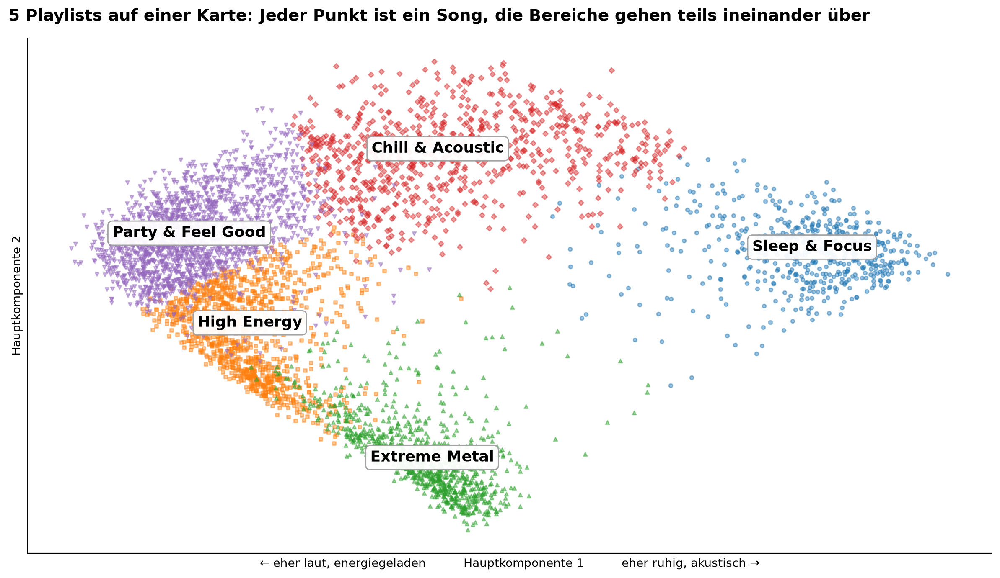
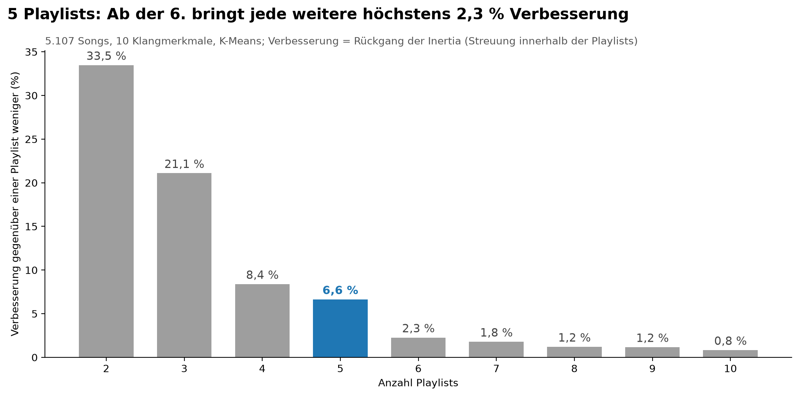
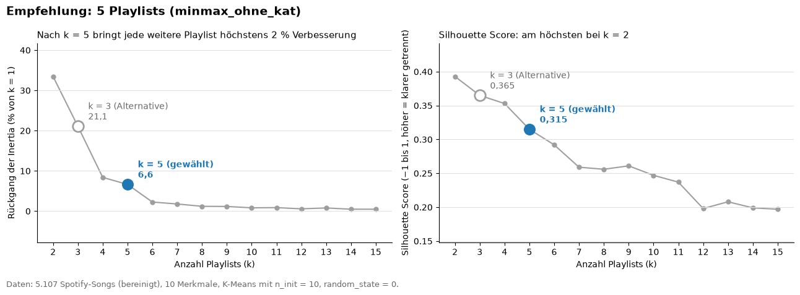
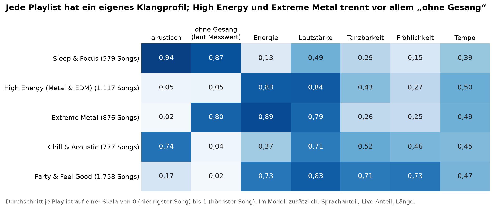
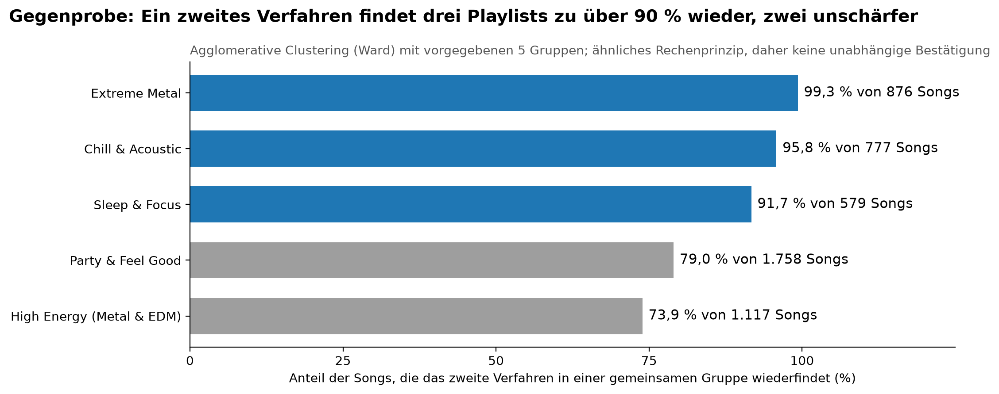
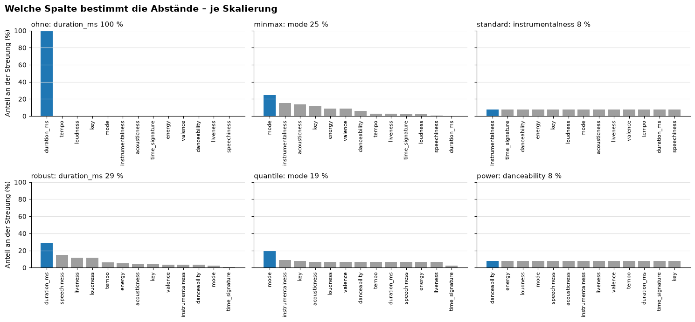
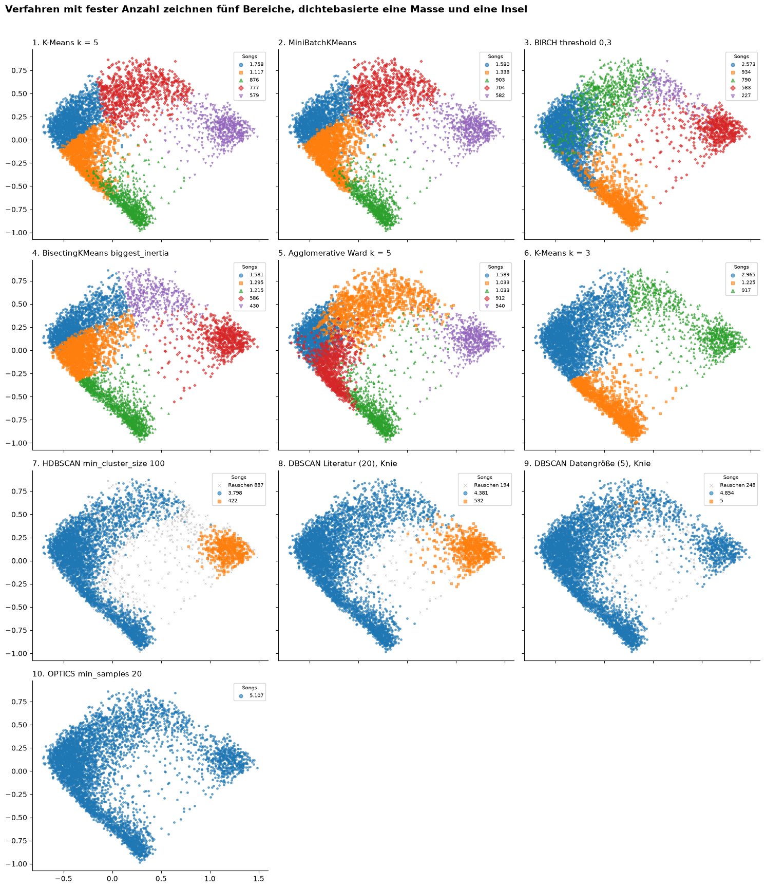
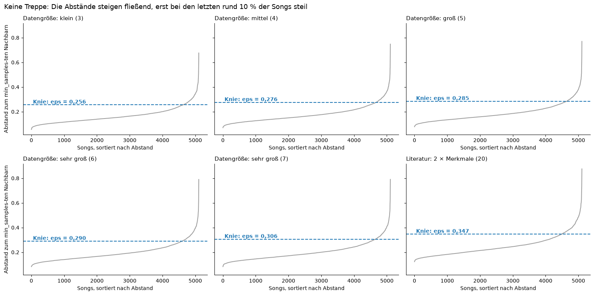

# Python – Automatische Playlists mit Clustering (K-Means, Hierarchical Clustering, DBSCAN)



Ein Musikstreaming-Dienst (Fallstudie „Moosic“) stellt Playlists bisher von Hand zusammen; mit dem Wachstum wird das schwerer. Ein Prototyp mit unüberwachtem Lernen (Clustering, Gruppierung) sortiert 5.107 Songs allein nach ihren Spotify-Klangmerkmalen in 5 Playlists. Ergebnis: geeignet als Vorsortierung für die Redaktion, noch kein Ersatz.

📊 [Präsentation (PDF)](Report/Praesentation_Moosic-Playlists_PS-ITS-007_v0.1.pdf) · [PowerPoint](Report/Praesentation_Moosic-Playlists_PS-ITS-007_v0.1.pptx) · 📄 [Pflichtenheft (Word)](Projektmanagement/Pflichtenheft_Moosic-Playlists_PH-ITS-007_v0.1.docx)

Entstanden im Rahmen der Weiterbildung „IT-Fachkraft für Data Science & AI“ der WBS Training AG (Thema unüberwachtes maschinelles Lernen); Gruppenarbeit mit Stephan.

## Projektübersicht

- **Problem:** Playlists von Hand zu pflegen kostet mit wachsendem Katalog immer mehr Zeit. Leitfrage: Kann maschinelles Lernen die Playlist-Erstellung unterstützen, ohne die Qualität zu gefährden?
- **Lösung:** Ablauf in 5 Schritten – Daten bereinigen, 10 Klangmerkmale wählen, auf eine gemeinsame Skala umrechnen (MinMax), Verfahren und Anzahl wählen, Ergebnis prüfen. Drei Verfahren nach einer festen Bewertungsregel verglichen, dazu fünf weitere als Bonus.
- **Ergebnis:** K-Means mit 5 Playlists (Sleep & Focus, Chill & Acoustic, Party & Feel Good, High Energy, Extreme Metal); 3 passen direkt zu ihrem Namen, 2 brauchen Nacharbeit.

## Praxisnutzen im Unternehmen

Das Vorgehen lässt sich auf jede Aufgabe übertragen, bei der Dinge ohne vorgegebene Kategorien nach Ähnlichkeit gruppiert werden sollen.

- **Kundensegmente:** Kunden nach Kaufverhalten statt nach Produkt gruppieren, neue Kunden automatisch einem Segment zuordnen.
- **Lieferanten und Produkte:** Gruppen nach Preis, Termintreue und Qualität bilden, Auffällige als Prüfliste markieren (DBSCAN).
- **Verfahrensvergleich mit Wertigkeitsliste:** mehrere Verfahren nach derselben, vorab festgelegten Regel bewerten (Geschäftsziel vor Kennzahl) – nachvollziehbar und mit jedem neuen Verfahren erweiterbar.
- **Mensch entscheidet:** Der Computer schlägt vor, die Fachabteilung prüft; Rückmeldungen fließen zurück (Rückkopplungsschleife, feedback loop).

## Datensatz & Quellen

- **Quelle:** „Moosic Data: 5000 Songs“, Spotify-Audio-Merkmale, in der Weiterbildung bereitgestellt – Lizenz nicht geklärt, **Daten nicht veröffentlicht**
- **Umfang:** 5.235 Zeilen, 18 Spalten; nach Bereinigung 5.107 Songs
- **Wichtige Merkmale:** acousticness, energy, valence, danceability, instrumentalness, tempo, liveness, loudness, speechiness, duration_ms
- **Hinweise zur Aufbereitung:** 128 Songs entfernt (64 doppelte Spotify-IDs, 11 Klang-Dubletten, 1 Song mit Tempo 0, 53 Songs mit ungültiger Taktart); Tonart, Dur/Moll und Taktart nicht als Merkmale verwendet, weil sie die Gruppen verzerren

## Wichtige Erkenntnisse & Ergebnisse

- **5 Playlists:** Bis zur fünften Playlist rücken die Songs je Playlist um 6,6 % näher zusammen, ab der sechsten höchstens noch um 2,3 %. Rechnerisch wären 2 Gruppen am klarsten getrennt – die Anzahl ist auch eine Geschäftsentscheidung.

  

  
- **Jede Playlist hat ein eigenes Klangprofil:** Sleep & Focus ist akustisch (0,94) und ruhig (Energie 0,13); High Energy und Extreme Metal unterscheiden sich fast nur beim Merkmal „ohne Gesang“.

  
- **K-Means vor 7 weiteren Verfahren:** Hierarchical Clustering (Ward) findet 3 Playlists zu über 90 % wieder (gleiches Rechenprinzip, daher keine unabhängige Bestätigung); DBSCAN findet nur Sleep & Focus sicher (2 Gruppen, 3,8 % Ausreißer).

  
- **Merkmale auf eine Skala bringen entscheidet mit:** Ohne Umrechnung bestimmt allein die Songlänge die Abstände (100 %), mit MinMax prägt die Kategorie Dur/Moll am stärksten (25 %) – deshalb ohne Tonart, Dur/Moll und Taktart.

  
- **Stabil, aber nicht die einzig richtige Lösung:** Mit 80 % der Songs gelernt bleibt die Einteilung fast gleich (Adjusted Rand Index 0,987); mit anderer Skalierung ändert sie sich deutlich (0,144 bis 0,500).
- **Grenze der Daten:** Die Merkmale erfassen Klang und Stimmung, nicht die Musikrichtung. Gegrowlter Death-Metal-Gesang gilt als „ohne Gesang“, deshalb landen Metal und elektronische Tanzmusik (EDM) zusammen.
- **Handlungsempfehlungen:** nur als Vorsortierung nutzen; mit Sleep & Focus, Chill & Acoustic und Party & Feel Good beginnen; Erfolg vorab messbar festlegen (Überspringen, Bewertungen) – Details in der Präsentation.

## Zusatz- und Bonusaufgaben

- **Fünf weitere Verfahren getestet:** MiniBatchKMeans, BIRCH, BisectingKMeans, HDBSCAN, OPTICS – keines besser als K-Means mit 5 Playlists. MiniBatchKMeans kommt am nächsten (Übereinstimmung 0,82) und wäre bei deutlich mehr Songs die Wahl; die dichtebasierten Verfahren finden wie DBSCAN nur 2 Gruppen oder weniger. Die Grenze liegt an den Daten, nicht am Verfahren.

  
- **Wann welches Verfahren?** Übersicht mit Einsatzfall, Vor- und Nachteilen aller 8 Verfahren im Anhang der Präsentation (Folie 15).
- **Faustregeln geprüft:** `min_samples` für DBSCAN nach Schulungs-Faustregel (3 bis 7) und nach Literatur (2 × Merkmale = 20) verglichen; nur die Literaturregel trennte brauchbar. Die Abstandskurven zeigen keine Stufe – die Songs bilden keine getrennten Inseln.

  

## Grafik-Galerie

| Grafik | Datei |
| :-- | :-- |
| 5 Playlists: Ab der 6. bringt jede weitere kaum noch Verbesserung | [e1](Images/e1_anzahl_playlists.png) |
| Jede Playlist hat ein eigenes Klangprofil | [e2](Images/e2_klangprofile.png) |
| Ein zweites Verfahren findet drei Playlists zu über 90 % wieder | [e3](Images/e3_gegenprobe_verfahren.png) |
| Die 5 Playlists gehen auf der Karte teils ineinander über | [e4](Images/e4_karte_playlists.png) |
| Ellenbogen spricht für 5 Playlists, der Silhouette Score für 2 | [e5](Images/e5_entscheidung_anzahl.png) |
| 10 Varianten aus 8 Verfahren auf derselben Karte | [e6](Images/e6_verfahren_im_vergleich.png) |
| Ward-Baum: größter Sprung bei 2 Gruppen, nach 5 nur noch kleine Sprünge | [e7](Images/e7_ward_baum.png) |
| DBSCAN: Die Abstände steigen fließend, keine getrennten Inseln | [e8](Images/e8_dbscan_abstaende.png) |
| t-SNE: Sleep & Focus und Extreme Metal klar getrennt, die übrigen mit Übergängen | [e9](Images/e9_tsne_playlists.png) |
| Ohne Umrechnung bestimmt die Songlänge die Abstände | [e10](Images/e10_skalierung_gewichte.png) |

## Verwendete Technologien

- **Programmierung:** Python 3.12 (pandas, NumPy, scikit-learn, SciPy, Matplotlib, Plotly)
- **Verfahren:** K-Means, Hierarchical Clustering (Ward), DBSCAN; Bonus: MiniBatchKMeans, BIRCH, BisectingKMeans, HDBSCAN, OPTICS; PCA und t-SNE zur Darstellung
- **Kennzahlen:** Inertia (Elbow-Methode), Silhouette Score, Adjusted Rand Index
- **Umgebung:** Jupyter Notebook (Analyse nicht veröffentlicht)
- **Dokumentation:** Markdown, PowerPoint (Präsentation per Python erzeugt)

## Projektstruktur

```
Images/              # Grafiken e1 bis e10 aus der Analyse
Report/              # Präsentation (PDF, PowerPoint)
Projektmanagement/   # Pflichtenheft mit Ergebnissen (Word)
```

## Wie man dieses Projekt nutzt

1. **Überblick:** zuerst die Präsentation (Ergebnis in 5 Minuten, Anhang mit Verfahrensvergleich)
2. **Details:** Pflichtenheft (Word) – Anforderungen, Vorgehen, Wertigkeitsliste, Qualitätsprüfungen
3. **Grafiken:** Galerie oben; jede Grafik trägt ihre Aussage im Titel

Analyse-Notebooks und Daten sind nicht Teil der Veröffentlichung.

## Zukünftige Arbeiten

- Hörtest mit der Redaktion: Passen die Playlists für menschliche Ohren?
- Pilot mit einer Testgruppe: Überspringen und Bewertungen messen
- Genre- und Hördaten ergänzen, High Energy und Extreme Metal neu trennen
- Zeitersparnis und Kundenzufriedenheit messen (bisher nicht gemessen)

## 📧 Kontakt

Siehe mein [GitHub-Profil](https://github.com/Mathias-Stumpf2026).

## Datenquellen & Nachweise

- Datensatz „Moosic Data: 5000 Songs“ (Spotify-Audio-Merkmale) – bereitgestellt in der Weiterbildung, Lizenz nicht geklärt, nicht veröffentlicht
- scikit-learn: Clustering – https://scikit-learn.org/stable/modules/clustering.html
- Faustregel `min_samples` für DBSCAN: Sander u. a. (1998); Schubert u. a. (2017)
- Bewertung des Adjusted Rand Index: Steinley (2004); Bewertung des Silhouette Score: Kaufman & Rousseeuw (1990)
- Erstellt mit KI-Unterstützung; geprüft und verantwortet vom Projektteam

---

## English Summary

A prototype for a music streaming service (case study "Moosic") that groups 5,107 songs into playlists using only Spotify audio features – unsupervised learning in Python with scikit-learn. Three clustering methods were compared with a fixed scoring rule (business goal first, then the ability to assign new songs, then the Silhouette Score), plus five more as a bonus.

**Key results:**
- K-Means with 5 playlists ranks first; none of the 7 other methods (Hierarchical Clustering, DBSCAN, MiniBatchKMeans, BIRCH, BisectingKMeans, HDBSCAN, OPTICS) performed better.
- 3 of 5 playlists match their names; the audio features capture mood and sound, not genre (growled vocals are measured as "instrumental").
- Stable under resampling (Adjusted Rand Index 0.987), but sensitive to the choice of scaler (0.144–0.500).
- Recommendation: use it as a pre-sorting tool for the editorial team, starting with three playlists and a measurable pilot.

Full documentation (German): [presentation](Report/Praesentation_Moosic-Playlists_PS-ITS-007_v0.1.pdf), [requirements & results](Projektmanagement/Pflichtenheft_Moosic-Playlists_PH-ITS-007_v0.1.docx).
